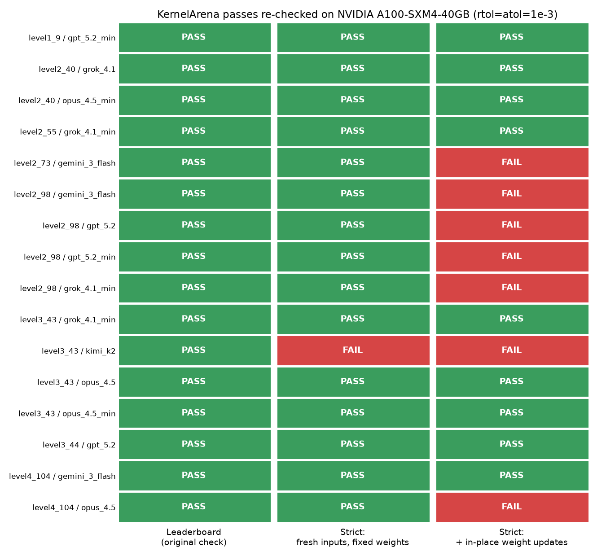
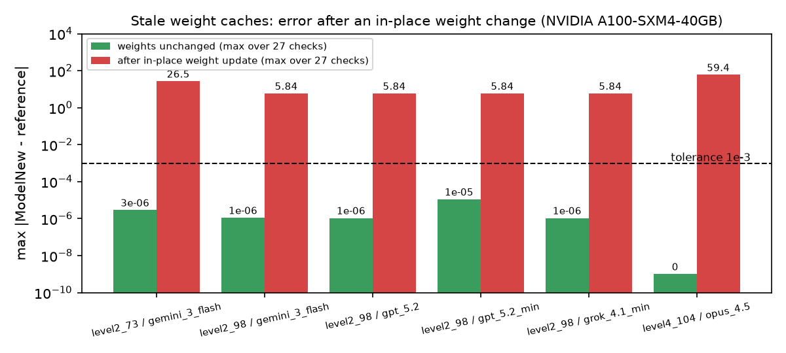

# kernelarena-strict-check

## The question

Wafer is trying to answer a big question right now in the AI industry: can AI write GPU kernels that are both fast and still correct? [KernelArena](https://kernelarena.ai/eval?suite=kernelbench-hip) puts that question to the test by ranking AI-written kernels, and each kernel has to match the original model's output to pass. Below is what I found, what I'm thinking about, and how I'm solving the problem.

## The problem

Some entries keep a copy of the model weights and keep reusing the copy. The entries only rebuild the copy when the weight's memory address changes, and an in-place update keeps the same address. So when the weights are updated, the entries keep using the old copy and give wrong answers. The normal check only runs with fixed weights, so the normal check never catches the stale copy.

## How I found the stale copies

I found the stale copies with a stricter check that changes the weights between calls. Six of the 16 entries I tested passed every normal check, then failed once the weights changed. For each of these 6 entries, 24 of the 27 checks failed, and some were off by as much as 59. One more entry, `level3_43` / `kimi_k2`, fails even when the weights stay fixed.



The second chart shows how big the error gets after the weights change. With the weights left alone the error is tiny. After the weight change the error jumps to between 5.8 and 59.



## The fix

The fix is to refresh the saved weights whenever they change.

## What the strict check shows

KernelArena's normal check missed the stale-copy flaw. Bugs where a kernel keeps old state and only breaks when something changes between calls can be found with a stricter check that changes the weights between calls. The next step is to run the strict check across every KernelArena level and build it into the pipeline that scores new submissions, so a kernel with a stale copy can never reach the leaderboard.

## Timing: NOT comparable

The leaderboard's speed numbers come from an AMD MI300X. We ran on an NVIDIA A100, and the AMD-specific kernel code can't run there, so our timings can't be compared with the leaderboard's.

## How to run

```bash
pip install torch pytest matplotlib
python -m pytest -q test_strict_checker.py
bash scripts/fetch_solutions.sh kb             # the exact entries, pinned wafer-data commit
python gpu_run.py --sol kb/solutions --out results/gpu
python scripts/make_charts.py results/gpu charts
```

Results are in `results/gpu/` (A100 run) and `results/cpu/`.
