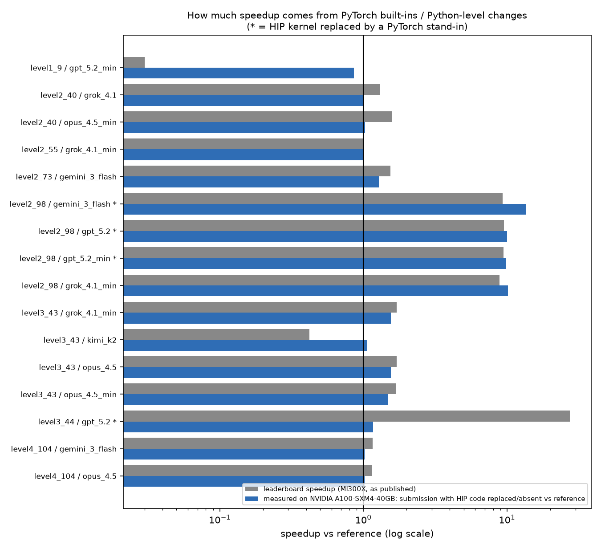

# kernelarena-strict-check

A stricter correctness check for [KernelArena](https://kernelarena.ai/eval?suite=kernelbench-hip) submissions
(the KernelBench HIP / MI300X suite published by Wafer in [wafer-ai/wafer-data](https://github.com/wafer-ai/wafer-data)),
and what it finds when you re-run the passing submissions on an NVIDIA GPU.

## The problem in one paragraph

The leaderboard checks each submission with one `torch.allclose` (rtol = atol = 1e-3) against the PyTorch reference.
Several "passing" submissions cache work derived from the weights (fused conv+BN weights, pooled Linear weights,
dequantized FP8 weights) and only rebuild the cache when the tensor's memory address, `id()`, device or dtype changes.
When the weights are updated in place (an optimizer step, `load_state_dict`, `copy_`), the address stays the same,
the cache goes stale, and the model silently returns wrong answers. A single-call check with fixed weights cannot see this.

## What I ran

On **NVIDIA A100-SXM4-40GB** (PyTorch 2.5.1+cu124, CUDA 12.4, TF32 off), for 16 passing submissions that can run on NVIDIA,
at the full KernelBench shapes plus edge-case batch sizes, with 3 seeds and 3 calls per shape (9 checks per mode):

1. **Strict, fixed weights:** fresh random inputs on every call; input-mutation and output-aliasing checks.
2. **Strict, in-place weight updates:** same, but the weights of both models get the same in-place update between calls.
3. **Timing:** median of 10 runs (after 3 warm-up runs) of the reference vs the submission.

HIP code cannot run on NVIDIA. Where a submission's custom HIP function was small and pure (GELU / scale / max),
it was replaced by a PyTorch stand-in with the same formula, copied from the HIP source; everything else in the file
(including the caching logic) ran unchanged. The note column says exactly what was ported for each row.

## Results (NVIDIA A100-SXM4-40GB)

| Submission | Leaderboard | Leaderboard speedup (MI300X) | Strict, fixed weights | Strict, in-place updates | Measured speedup on NVIDIA A100-SXM4-40GB | What ran |
|---|---|---|---|---|---|---|
| `level1_9_Tall_skinny_matrix_multiplication_` / `gpt_5.2_min` | pass | 0.03 | pass (0/9 failed) | pass (0/9 failed, max err 0) | 0.86x | pure PyTorch |
| `level2_40_Matmul_Scaling_ResidualAdd` / `grok_4.1` | pass | 1.3 | pass (0/27 failed) | pass (0/27 failed, max err 0) | 1.01x | pure PyTorch |
| `level2_40_Matmul_Scaling_ResidualAdd` / `opus_4.5_min` | pass | 1.58 | pass (0/27 failed) | pass (0/27 failed, max err 0) | 1.03x | pure PyTorch |
| `level2_55_Matmul_MaxPool_Sum_Scale` / `grok_4.1_min` | pass | 1 | pass (0/27 failed) | pass (0/27 failed, max err 0) | 1.00x | pure PyTorch |
| `level2_73_Conv2d_BatchNorm_Scaling` / `gemini_3_flash` | pass | 1.54 | pass (0/27 failed) | FAIL (24/27 failed, max err 26.5) | 1.28x | pure PyTorch |
| `level2_98_Matmul_AvgPool_GELU_Scale_Max` / `gemini_3_flash` | pass | 9.3 | pass (0/27 failed) | FAIL (24/27 failed, max err 5.84) | 13.57x | HIP post_matmul_fused_hip replaced by PyTorch stand-in (erf GELU*scale, max over dim 1); Python weight-cache logic unchanged |
| `level2_98_Matmul_AvgPool_GELU_Scale_Max` / `gpt_5.2` | pass | 9.5 | pass (0/27 failed) | FAIL (24/27 failed, max err 5.84) | 10.04x | HIP gelu_scale_max_hip replaced by PyTorch stand-in (erf GELU*scale, max over dim 1); Python weight-cache logic unchanged |
| `level2_98_Matmul_AvgPool_GELU_Scale_Max` / `gpt_5.2_min` | pass | 9.47 | pass (0/27 failed) | FAIL (24/27 failed, max err 5.84) | 9.89x | HIP gelu_scale_max replaced by PyTorch stand-in (tanh GELU as in the HIP source); Python weight-cache logic unchanged |
| `level2_98_Matmul_AvgPool_GELU_Scale_Max` / `grok_4.1_min` | pass | 8.88 | pass (0/27 failed) | FAIL (24/27 failed, max err 5.84) | 10.18x | pure PyTorch |
| `level3_43_MinGPTCausalAttention` / `grok_4.1_min` | pass | 1.7 | pass (0/27 failed) | pass (0/27 failed, max err 9.35e-05) | 1.56x | pure PyTorch (SDPA) |
| `level3_43_MinGPTCausalAttention` / `kimi_k2` | pass | 0.42 | FAIL (27/27 failed) | FAIL (27/27 failed, max err 0.584) | 1.06x | pure PyTorch |
| `level3_43_MinGPTCausalAttention` / `opus_4.5` | pass | 1.71 | pass (0/27 failed) | pass (0/27 failed, max err 9.35e-05) | 1.56x | pure PyTorch (SDPA) |
| `level3_43_MinGPTCausalAttention` / `opus_4.5_min` | pass | 1.69 | pass (0/27 failed) | pass (0/27 failed, max err 9.35e-05) | 1.48x | pure PyTorch (SDPA) |
| `level3_44_MiniGPTBlock` / `gpt_5.2` | pass | 27.33 | pass (0/27 failed) | pass (0/27 failed, max err 0.000851) | 1.17x | HIP new_gelu_forward replaced by PyTorch NewGELU stand-in (same tanh formula); attention is SDPA as submitted |
| `level4_104_FP8_Matmul` / `gemini_3_flash` | pass | 1.16 | pass (0/27 failed) | pass (0/27 failed, max err 0.000187) | 1.02x | torch.compile as submitted; reference ASSUMED; A100 has no FP8 Triton support, so torch.compile falls back to eager (suppress_errors=True) |
| `level4_104_FP8_Matmul` / `opus_4.5` | pass | 1.14 | pass (0/27 failed) | FAIL (24/27 failed, max err 59.4) | 1.02x | HIP input-quant extension not built, so the file's own PyTorch fallback runs; weight-cache code unchanged; reference ASSUMED |


**Stale weight caches: 6 of 16** submissions pass every fixed-weight check and then fail after an in-place weight update:

- `level2_73_Conv2d_BatchNorm_Scaling` / `gemini_3_flash`: max error with fixed weights 2.86e-06, after in-place update 26.5 (24/27 checks fail)
- `level2_98_Matmul_AvgPool_GELU_Scale_Max` / `gemini_3_flash`: max error with fixed weights 1.1e-06, after in-place update 5.84 (24/27 checks fail)
- `level2_98_Matmul_AvgPool_GELU_Scale_Max` / `gpt_5.2`: max error with fixed weights 1.07e-06, after in-place update 5.84 (24/27 checks fail)
- `level2_98_Matmul_AvgPool_GELU_Scale_Max` / `gpt_5.2_min`: max error with fixed weights 1.11e-05, after in-place update 5.84 (24/27 checks fail)
- `level2_98_Matmul_AvgPool_GELU_Scale_Max` / `grok_4.1_min`: max error with fixed weights 1.07e-06, after in-place update 5.84 (24/27 checks fail)
- `level4_104_FP8_Matmul` / `opus_4.5`: max error with fixed weights 0, after in-place update 59.4 (24/27 checks fail)


**Fails even with fixed weights: 1** (`level3_43_MinGPTCausalAttention` / `kimi_k2`; max error 0.0744). I did not investigate the root cause.

**Clean: 9 of 16** pass both strict modes.

### Where the speedup comes from



- `level2_98` (Matmul + AvgPool + GELU + Scale + Max): leaderboard 8.88–9.5x. On NVIDIA A100-SXM4-40GB, with the HIP kernel
  replaced by plain PyTorch (or absent), the submissions are still 9.9–13.6x faster than the reference.
  So on this GPU the speedup comes from an algebraic rewrite (averaging the Linear weights in groups of 16, so the matmul is 16x smaller), not from the custom kernel. This rewrite is exactly what gets cached and goes stale.
- `level3_44_MiniGPTBlock` / `gpt_5.2`: leaderboard 27.33x. With its only HIP kernel (GELU) replaced by PyTorch, the rest of the file (which uses PyTorch SDPA) gives 1.17x on NVIDIA A100-SXM4-40GB.
- `level3_43` SDPA submissions: leaderboard 1.7, 1.71, 1.69x, measured 1.56, 1.56, 1.48x on NVIDIA A100-SXM4-40GB, entirely from PyTorch's built-in attention.

### FP8 input path that never rounds to FP8 (reproduction)

In `level4_104_FP8_Matmul` / `opus_4.5`, the HIP function `fast_fp8_quant_dequant_hip` scales, clamps and unscales in fp16
but never casts to an FP8 type, so the input is returned unchanged. Reproducing that math in PyTorch at [16384, 4096, 4096] on NVIDIA A100-SXM4-40GB and comparing to real FP8
quantize-dequantize gives max error 0.194–0.201 (relative error 2.66%) over 3 seeds; it fails allclose at both 1e-3 and 1e-2.
This is a reproduction of the HIP math, not the HIP kernel itself.

## The fix

`strict_checker.py` (pure PyTorch, device-agnostic): fresh inputs per call, in-place weight updates between calls, several
seeds, edge-case shapes, input-mutation and output-aliasing checks, plus `static_audit()` that tells you whether
`ModelNew.forward` calls custom code at all. Unit tests on CPU: `11 passed in 1.43s` (stale weight cache, cached output,
shape-specialised output, input mutation, honest model, and three audit cases).

For submissions, caching weight-derived tensors is fine if the cache key is the parameter's in-place version counter
(`weight._version`) rather than its address (suggested fix; not benchmarked here).

## Static audit of all submissions (CPU)

Of 444 submission files, 417 passed on the leaderboard; the audit finds 15 passes with no custom kernel code at all
(10 of them with speedup > 1). The "custom kernel unused in forward" count in
`results/cpu/static_audit_summary.json` is a heuristic and overcounts (it misses kernels called through helpers), so treat it as unreliable.

## Limits

- **Everything here ran on NVIDIA (NVIDIA A100-SXM4-40GB) or CPU, not on MI300X.** Speedups on another GPU are not the leaderboard's speedups;
  they only show how much speedup the non-HIP parts give on that GPU.
- HIP kernels were not compiled. Only small pure functions were replaced by PyTorch stand-ins (listed per row).
- Wafer's level-4 reference implementations are not public. For `level4_104_FP8_Matmul` the reference is an **assumed**
  FP8 quantize-dequantize of input and current weight. Other level-4 passes (101, 103, 105) were not checked for that reason.
- Level 1–3 references are the upstream [KernelBench](https://github.com/ScalingIntelligence/KernelBench) files in `refs/` (MIT license).
- In-place weight updates are a stricter condition than the leaderboard's own protocol. They matter in real use (fine-tuning, weight reloading, serving updates).

## Reproduce

```bash
pip install torch pytest matplotlib
python -m pytest -q test_strict_checker.py
bash scripts/fetch_solutions.sh kb             # the exact submissions, pinned wafer-data commit
python gpu_run.py --sol kb/solutions --out results/gpu
python scripts/make_charts.py results/gpu charts
python scripts/gen_readme.py
```
